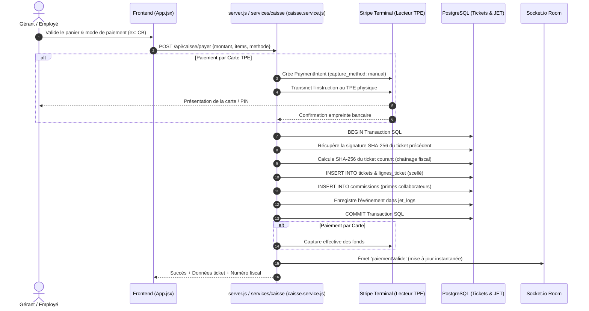
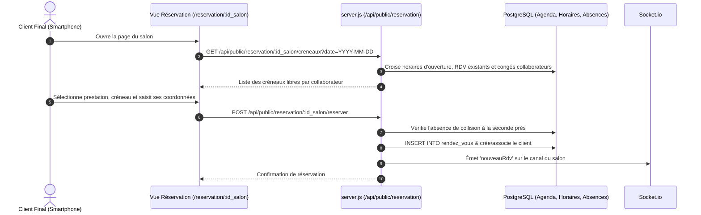
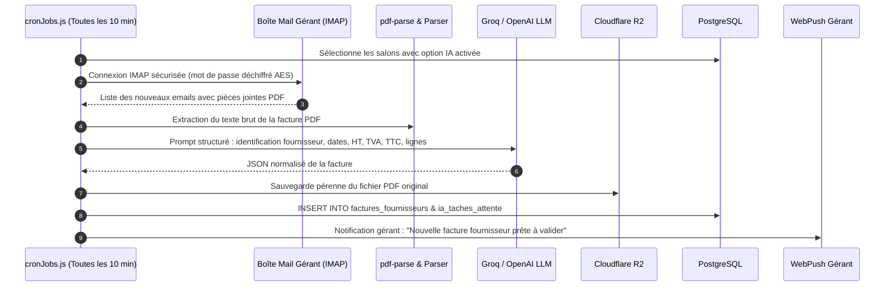
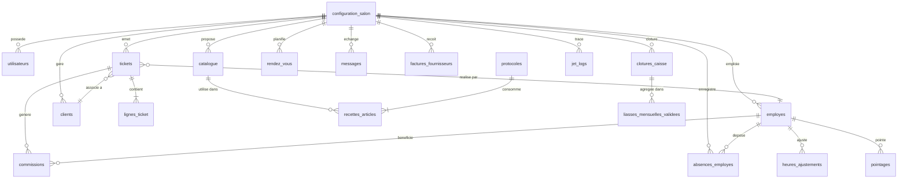
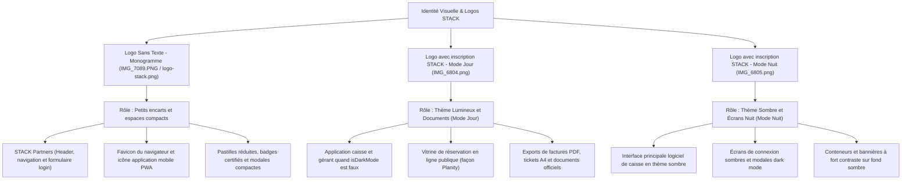
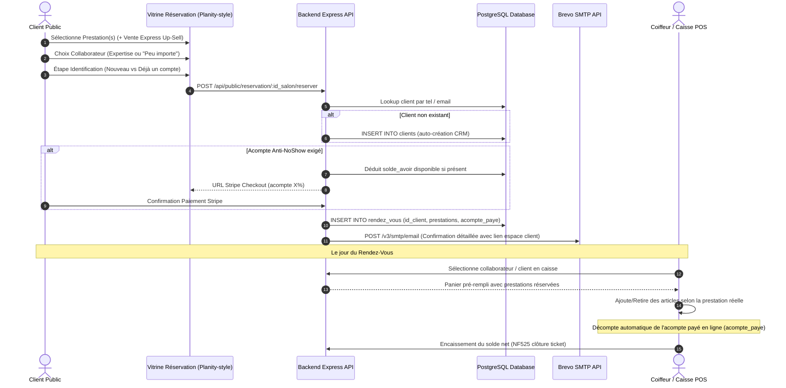

# 🏛️ Architecture Globale — Application STACK

> **Document de référence architectural**  
> *Dernière mise à jour : 05/11/2026*  
> *Statut du code analysé : Répertoire local `APP-GITHUB` (branche `main`)*

---

## 1. Vue d'Ensemble du Système

**STACK** est une plateforme SaaS tout-en-un destinée aux gérants et équipes de salons de coiffure et instituts de beauté. L'application combine :
1. **Un terminal point de vente (Smart POS)** certifié conforme à la norme fiscale **NF525** (inaltérabilité, traçabilité, conservation, archivage).
2. **Un agenda métier et une borne de réservation en ligne** publique avec calcul dynamique de créneaux.
3. **La gestion des collaborateurs (RH)** : pointeuse digitale, calcul des heures travaillées, suivi des commissions, primes, gestion des congés et arrêts avec justificatifs sécurisés.
4. **La gestion prédictive des stocks** et le réassort automatique auprès des fournisseurs avec bons de commande PDF.
5. **Un robot comptable autonome (IA)** capable d'ingérer les emails fournisseurs (IMAP), d'extraire les données des factures PDF (Groq/OpenAI) et de préparer les écritures comptables.
6. **Une liasse fiscale et export FEC** (Fichier des Écritures Comptables) conforme aux normes DGI.
7. **Un système de marketing relationnel** : relance prédictive des clients dormants (winback) et collecte d'avis de satisfaction via SMS (Brevo).
8. **Une messagerie interne d'équipe** en temps réel (Socket.io) avec audio, photos et réactions.
9. **Un portail dédié aux agents commerciaux partenaires** pour la distribution et l'équipement matériel (TPE Stripe).

---

## 2. Diagramme Architectural Global

```mermaid
flowchart TB
    subgraph Clients["📱 Clients & Interfaces Utilisateurs"]
        PWA["PWA React 19 (Desktop / iPad / Mobile)<br/>App.jsx & LiquidTabBar"]
        PublicBooking["Borne Réservation Publique<br/>App.jsx /reservation/:id"]
        PublicReview["Borne Avis Client Publique<br/>AvisPublic.jsx /avis/:token"]
        PartnerPortal["Portail Partenaires Agents<br/>stack-partners-frontend"]
    end

    subgraph CDN_Gateway["🌐 Passerelle & Hébergement"]
        RenderFE["Render Frontend (Static Web Service)<br/>app-salon-caiss.onrender.com"]
        RenderAPI["Render API Backend (Web Service Node.js)<br/>api-salon-backend.onrender.com"]
        CORS["CORS Handler & Express Rate Limiters"]
    end

    subgraph BackendCore["⚙️ Backend Node.js / Express 5 (server.js - Orchestrateur)"]
        direction TB
        CFG_DB["config/db.js<br/>(Pool PG, migrations, triggers NF525)"]
        MW["services/auth/auth.service.js<br/>(verifierToken, verifierPlan, verifierSuperAdmin, limiters)"]
        RouterPartners["Routeur Partenaires (routes_partners.js)"]
        ModuleLegal["Module Légal & Signature (legal.js)"]
        
        subgraph ModularServices["📦 Services Métier Découplés (100% Modulaire)"]
            SRV_Auth["services/auth/<br/>(auth.service.js)"]
            SRV_Caisse["services/caisse/<br/>(caisse.service.js, dossierNf525Pdf)"]
            SRV_Clients["services/clients/<br/>(clients.service.js)"]
            SRV_Notif["services/notifications/<br/>(notifications.service.js)"]
            SRV_Settings["services/settings/<br/>(settings.service.js)"]
            SRV_Compta["services/compta/<br/>(fec, clotureMensuelle, archiveFiscale)"]
            SRV_PDF["services/pdf/<br/>(ticketPdf, liassePdf, bonCommandePdf, legalAcceptancePdf)"]
            SRV_Stock["services/stock/<br/>(stock.service.js)"]
            SRV_RH["services/rh/<br/>(rh.service.js, employes.service.js)"]
            SRV_Proto["services/protocoles/<br/>(protocoles.service.js)"]
            SRV_Chat["services/chat/<br/>(chat.service.js)"]
            SRV_Mktg["services/marketing/<br/>(marketing.service.js)"]
            SRV_Agenda["services/agenda/<br/>(agenda.service.js)"]
            SRV_Salons["services/salons/<br/>(salons.service.js)"]
            SRV_Stripe["services/stripe/<br/>(stripe.service.js)"]
            SRV_IA["services/ia/<br/>(ia.service.js)"]
            SRV_Dashboard["services/dashboard/<br/>(dashboard.service.js)"]
            SRV_Admin["services/admin/<br/>(superadmin.service.js)"]
        end

        subgraph BackgroundJobs["⏱️ Tâches de Fond & Robots (jobs/cronJobs.js)"]
            CronRobotIA["Robot Comptable IMAP/IA"]
            CronCloture["Clôture Fantôme (3h00)"]
            CronHebdo["Rapport Hebdo Gérant (Lundi 8h00)"]
            CronSMS["Rappels RDV & Marketing Prédictif (Brevo)"]
            CronAvis["Robot Avis Satisfaction"]
        end
    end

    subgraph DataStorage["💾 Stockage & Persistance"]
        PG[("PostgreSQL Render<br/>35+ Tables relationnelles")]
        R2[("Cloudflare R2 Object Storage<br/>(Photos, Justificatifs, Factures)")]
    end

    subgraph ExternalServices["🔌 Services Tiers & Intégrations"]
        Stripe["Stripe API & Stripe Terminal POS"]
        Brevo["Brevo API (Envoi SMS)"]
        Groq["Groq / OpenAI API (LLM Extraction Factures)"]
        Gmail["Gmail IMAP & SMTP (Nodemailer)"]
        Sentry["Sentry Monitoring (Erreurs Node & React)"]
        VAPID["WebPush (VAPID Notifications)"]
    end

    %% Connexions Clients -> Passerelle
    PWA -->|"HTTPS REST + WSS"| RenderAPI
    PublicBooking -->|"HTTPS REST"| RenderAPI
    PublicReview -->|"HTTPS REST"| RenderAPI
    PartnerPortal -->|"HTTPS REST"| RenderAPI
    RenderFE -.->|"Sert les assets statiques"| PWA

    %% Passerelle -> Backend
    RenderAPI --> CORS --> MW
    MW --> ModularServices
    MW --> RouterPartners
    MW --> ModuleLegal

    %% Backend -> Jobs
    RenderAPI -.->|"Initialise au boot"| BackgroundJobs

    %% Backend & Jobs -> BDD / Storage
    CFG_DB --> PG
    ModularServices --> PG
    RouterPartners --> PG
    BackgroundJobs --> PG
    
    ModularServices --> R2
    BackgroundJobs --> R2

    %% Backend & Jobs -> Services Externes
    ModularServices --> Stripe
    BackgroundJobs --> Brevo
    BackgroundJobs --> Groq
    BackgroundJobs --> Gmail
    ModularServices --> Sentry
    SRV_Notif --> VAPID
```

---

## 3. Description des Couches Techniques

### 3.1. Couche Frontend (SPA Progressive Web App & Architecture Modulaire)
- **Framework** : React 19.2.8 avec Vite 8.3.0.
- **PWA & Offline** : `vite-plugin-pwa`, `sw.js` pour les notifications push web, et `localforage` (IndexedDB) pour le cache hors-ligne du catalogue et du panier caisse (`offline_tickets`).
- **Gestion des états & Architecture Modulaire** : Composant racine `App.jsx` agissant comme orchestrateur principal allégé (réduit de 11 553 à **1 865 lignes** [-83.8%], dont le JSX est entièrement découpé en composants autonomes et la logique métier extraite dans 20 custom hooks dédiés dans `frontend/src/hooks/`) :
  - `frontend/src/hooks/` :
    - `useAuthSession.js` : Authentification multi-rôles (gérant, salon, employé avec code PIN), gestion des tokens JWT, conformité légale NF525 (CGV/Politique), mot de passe oublié et Reverse Trial Stripe.
    - `useCaissePOS.js` : Terminal Smart POS NF525, panier réactif, pourboires, remises, encaissement espèces/CB Stripe Terminal, génération de tickets et queue hors-ligne `localforage`.
    - `useClotureZ.js` : Clôture journalière Z certifiée NF525, calculatrice de caisse Blind Close, régularisation matinale obligatoire, contrôle d'écarts avec justification et alertes de fermeture.
    - `useAgendaPlanning.js` : Planning hebdomadaire des collaborateurs, détection de collisions, CRUD de rendez-vous, absences/congés et upload justificatifs Cloudflare R2.
    - `useStocksReassort.js` : Scanner code-barres caméra HTML5 / manuel avec bip audio, seuils d'alerte rupture, panier de réassort fournisseur, génération PDF et email.
    - `usePointeuseRH.js` : Pointeuse tactile 4 étapes, saisie PIN avec lockout exponentiel NF525 (3, 5, 7, 9 tentatives), chronomètres live et déblocage gérant.
    - `useComptaValidation.js` : Validation mensuelle des écritures comptables, canvas de signature manuscrite tactile, 3 points de contrôle et scellement d'archive fiscale.
    - `useInternalChat.js` : Messagerie d'équipe temps réel (Socket.io), mémos vocaux (MediaRecorder), pastilles non-lus `localforage`, accusés de lecture "Vu par" et réactions emojis.
    - `useMultiSalons.js` : Multi-établissements et franchise, création de succursales et bascule instantanée avec purge du cache local.
    - `useFacturesOCR.js` : Moteur OCR de détection et d'extraction de factures par IA, connexion SSE temps réel, file d'attente de documents, simulateur salon démo et saisie manuelle.
    - `useProtocolesCoiffure.js` : Académie technique, fiches recettes de coiffure, étapes avec proportions de produits, photos/médias et calcul de rentabilité.
    - `useEntitiesCRUD.jsx` : Gestion CRUD centralisée des clients, employés, prestations du catalogue et stocks, exports comptables (FEC, liasse PDF) et audit cryptographique NF525.
    - `useOfflineSync.js` : Écouteur réseau (online/offline), boucle de vérification (3s/5min) et vidage automatique de la file d'attente des tickets hors-ligne scellés.
    - `useMouvementsCaisse.js` : Mouvements d'espèces de caisse (entrées/sorties), calculatrice de pièces et billets, motifs prédéfinis et contrôle PIN.
    - `useGamificationEquipe.js` : Objectifs d'équipe, paliers et KPIs collaborateurs gamifiés, modales de gestion et de suivi en temps réel.
    - `useActionsChecklist.js` : Checklist Go-Live de démarrage salon, campagne SMS de sauvetage client (winback), to-do list et fusion de doublons de stocks.
    - `useAppDataLoader.js` : Moteur de synchronisation globale IndexedDB (`localforage`), auto-fetch et écouteurs WebSockets temps réel (nouveaux RDV, paiements validés, chat).
    - `usePricingLock.js` : Gestion de la logique de monétisation SaaS (Reverse Trial, soft lock, hard lock) et filtrage des accès par niveau d'abonnement (Essential, Pro, Premium).
    - `useResponsiveAgendaDate.js` : Écouteur responsive dynamique (mobile 3j, tablette 4j, desktop 7j) et pagination temporelle de l'agenda avec bornes d'ouverture.
    - `useSalonSettings.js` : Sauvegarde des paramètres de configuration du salon (horaires, sécurité PIN établissement NF525) et souscription aux notifications push Web/Mobile.
  - `frontend/src/utils/auth.js` : décodage JWT/UI-token sécurisé, transformation VAPID Uint8Array et vérification des règles de complexité PIN.
  - `frontend/src/utils/pin.js` : helpers de sécurité NF525 pour la gestion des tentatives et blocages PIN temporaires/définitifs (`getStatutBlocagePin`, `appliquerRetourPinLocal`).
  - `frontend/src/utils/fetchClient.js` : client HTTP intercepteur injectant automatiquement les cookies de session et le jeton Bearer sur toutes les requêtes API.
  - `frontend/src/utils/text.js` : normalisation de recherche, formatage de noms, dates et portions de produits techniques.
  - `frontend/src/utils/protocoles.js` : normalisation et validation des étapes de tutoriels/recettes techniques.
  - `frontend/src/constants/theme.js` : constantes visuelles partagées (`COULEURS_EMPLOYES`).
  - `frontend/src/pages/ReservationPublique.jsx` : borne autonome de réservation en ligne publique anti-Planity avec calcul des créneaux et fidélité instantanée.
  - `frontend/src/components/auth/LoginView.jsx` : écran de connexion unifié (Gérant email/mdp, Employé PIN, Salon PIN, Récupération de mot de passe).
  - `frontend/src/components/common/` : composants graphiques mutualisés (`ThemeToggle.jsx`, `Avatar.jsx`, `SvgEmptyState.jsx`, `ToastNotification.jsx`, `SimulateurIAButton.jsx`).
  - `frontend/src/components/navigation/` :
    - `NavbarSidebar.jsx` : barre de navigation latérale desktop et intégration mobile `LiquidTabBar`.
    - `BottomMenuOutils.jsx` : menu tiroir mobile "Outils & Gestion" (Académie, Stocks, Équipe, Compta, God Mode, Chat, Déconnexion).
    - `AppHeaderBanners.jsx` : bannières d'alertes supérieures (expiration essai Stripe, rappel Z obligatoire, contrôle stock, notification clôture fantôme, statut hors-ligne et compteur de tickets locaux en attente).
  - `frontend/src/components/modals/` :
    - `RegularisationZModal.jsx` : modal de régularisation obligatoire d'ouverture de caisse et clôtures fantômes avec saisie du fond de caisse initial et sécurité PIN.
    - `MouvementCaisseModal.jsx` : modal de gestion de la petite caisse (entrées/sorties d'espèces), calculatrice billets/pièces, motifs types et validation PIN employé.
    - `ClotureZDialog.jsx` : dialogue officiel de clôture journalière Z certifiée NF525 avec comptage physique de caisse, calcul d'écarts avec justification obligatoire, et scellement cryptographique.
    - `AnnulationTicketModal.jsx` : modal d'annulation de vente et génération de ticket de compensation négatif conforme NF525 avec sélection des lignes d'articles remboursées.
    - `ActionDialogs.jsx` : suite de dialogues opérationnels (`ConfirmDialog`, `ModifStockDialog`, `ModifNomDialog`, `CancellationRobotDialog`, `AuditNf525Dialog`, `SauvetageClientDialog`).
    - `PointeuseModal.jsx` : pointeuse digitale tactile 4 étapes avec sélection collaborateur, saisie code PIN sécurisée avec gestion de lockout, sélection d'action (arrivée, pause, départ) et validation visuelle animée.
    - `FusionStocksModal.jsx` : modal de dédoublonnage et d'unification des stocks avec prévisualisation des doublons détectés.
    - `SaisieFactureManuelleModal.jsx` : modal de saisie manuelle de dépenses/factures avec calcul automatique/manuel de TVA, imputation de compte comptable et contrôle PIN gérant.
    - `ModalIA.jsx` : interface d'arbitrage IA d'extraction de factures (aperçu PDF iframe, contrôle HT/TVA/TTC, génération automatique de fiches de stock), analyse de rendez-vous et congés.
    - `ValidationComptaModal.jsx` : modal de certification mensuelle gérant avec 3 points de contrôle obligatoires, signature manuscrite tactile sur canvas et scellement d'archive NF525.
  - `frontend/src/components/dashboard/DashboardTab.jsx` : tableaux de bord multi-rôles (Poste Salon, Salarié/Coiffeur, et Gérant avec KPIs exécutifs).
  - `frontend/src/components/caisse/CaisseTab.jsx` : terminal de caisse Smart POS NF525, catalogue interactif, scanner code-barres caméra, pourboires, fidélité et checklist go-live.
  - `frontend/src/components/actions/ActionsTab.jsx` : centre d'action opérationnel, gestion des tâches, sauvetage client winback et OCR factures IA.
  - `frontend/src/components/agenda/AgendaTab.jsx` : planning hebdomadaire interactif, détection de collisions, modales RDV/absences et lecteur pas-à-pas de protocoles.
  - `frontend/src/components/protocoles/ProtocolesTab.jsx` : Académie technique, éditeur pas-à-pas d'étapes avec proportions de produits, photos et minuteurs.
  - `frontend/src/components/stock/StocksTab.jsx` : inventaire des produits labo/revente, réassort intelligent avec bons de commande PDF et fusion de doublons.
  - `frontend/src/components/rh/RHTab.jsx` : pilotage RH, gestion des collaborateurs, fiches de paie, suivi des objectifs d'équipe, congés et arrêts maladie.
  - `frontend/src/components/admin/AdminTab.jsx` : comptabilité, clôture journalière Z scellée NF525, petite caisse espèces et historiques annuels/mensuels.
  - `frontend/src/components/chat/MessagerieTab.jsx` : messagerie d'équipe instantanée (Teams-style), mémos vocaux, photos et accusés de lecture ("Vu par").
  - `frontend/src/components/superadmin/SuperAdminTab.jsx` : God Mode fondateur STACK, supervision du parc de salons, MRR et déclenchement manuel des robots CRON.
  - `frontend/src/context/` : contextes d'état partagé (`AuthContext.jsx`, `SocketContext.jsx`).
  - `Parametres.jsx` : panneau de configuration salon (TPE, SMS, alertes, forfaits, exports comptables).
  - `LiquidTabBar.jsx` : barre de navigation flottante avec retours haptiques.
  - `PopupLegal.jsx` : modal bloquante de signature contractuelle électronique lors de la première connexion.
  - `PricingModal.jsx` : sélecteur de formules Stripe (Essentiel / Pro / Premium).
  - `AvisPublic.jsx` : vue publique dédiée aux clients recevant un lien SMS de satisfaction.
- **Point de configuration API** : `frontend/src/api/config.js` détecte automatiquement l'hôte (`localhost` vs domaine de production Render) pour router les requêtes.

### 3.2. Couche Passerelle & Contrôle d'Accès
- **Serveur HTTP** : Node.js avec Express 5.2.1.
- **Sécurité Réseau & CORS** : Restriction des origines autorisées (`app-salon-caiss.onrender.com`, `localhost:5173`, `stack-partners-frontend.onrender.com`), transmission des cookies avec `credentials: true`.
- **Limiteurs de Débit (`express-rate-limit`)** :
  - `authLimiter` : protège les endpoints sensibles (`/api/login`, `/api/employes/login-pin`, `/api/register`, `/api/forgot-password`).
  - `limiteurReservationPublique` & `limiteurAvisPublic` : prévient le scraping et les attaques par déni de service sur les routes publiques ouvertes.
- **Authentification & Session** :
  - JWT stockés dans des cookies HTTP-Only (`token`, `sameSite: none`, `secure: true`) et délivrance parallèle d'un `ui_token` pour l'interface React.
  - Middleware `verifierToken` : valide le jeton et extrait le contexte `{ id_salon, role, id_employe }`.
  - Middleware `verifierPlan(['PRO', 'PREMIUM'])` : contrôle d'accès aux fonctionnalités avancées (IA, OCR factures, pointeuse).
  - Middleware `verifierSuperAdmin` : réservé au support technique et administration globale.

### 3.3. Couche Métier & Services Modulaires (100% Découplée)
L'intégralité du backend est organisée en 15 domaines fonctionnels autonomes injectant leurs dépendances :
- `config/db.js` : configuration centralisée du pool PostgreSQL, synchronisation et migrations automatiques du schéma relationnel (tables, colonnes, contraintes d'unicité, clés VAPID et triggers stricts d'inaltérabilité NF525).
- `services/auth/` : authentification unifiée, chiffrement bidirectionnel AES-256-CBC, contrôle des codes PIN faibles, sessions JWT avec cookies HTTP-Only, vérification des plans d'abonnement (PRO/PREMIUM), paliers de verrouillage NF525 (15m, 30m, 1h, définitif), flux d'oubli/réinitialisation de mot de passe et limiteurs anti-brute force (`authLimiter`, `limiteurAvisPublic`, `limiteurReservationPublique`).
- `services/notifications/` : notifications temps réel Server-Sent Events (SSE), notifications push web VAPID multi-cibles (gérant, employé, groupe), normalisation des numéros de téléphone et passerelle transactionnelle SMS intelligente (Brevo) avec contrôle des quotas mensuels.
- `services/settings/` : configuration globale du salon (GMB, Pennylane, horaires, fidélité, coordonnées bancaires et comptables), checklist d'onboarding go-live pour déverrouiller la caisse, masquage des secrets pour le personnel non-gérant et traçabilité JET.
- `services/clients/` : annuaire clients, historique d'achats/visites/gains de fidélité, notes techniques, et suppression avec anonymisation pseudonymisée RGPD préservant la conservation fiscale NF525 des tickets liés.
- `services/pdf/legalAcceptancePdf.service.js` : middleware SSO Sandbox (accès direct caisse pour salons DEMO et VIDE) et générateur vectoriel PDFKit du certificat officiel d'acceptation électronique des CGUV, RGPD et SEPA (2 pages certifiées, empreintes SHA-256).
- `services/caisse/` : Caisse Smart POS, encaissements multi-moyens (CB Stripe Terminal, espèces, pourboires isolés, fidélité), annulations partielles ou totales avec écritures de compensation, mouvements scellés d'espèces avec contrôle PIN collaborateur, clôture journalière Z avec cumul perpétuel inaltérable, contrôle matinal de régularisation et audit de conformité cryptographique NF525 (dossier technique légal PDF, vérification continue de la chaîne SHA-256 et JET logs).
- `services/pdf/` : moteurs de rendu vectoriel PDFKit pour tickets de caisse scellés, liasses mensuelles certifiées, bons de commande fournisseurs et certificats contractuels légaux.
- `services/compta/` : génération du Fichier des Écritures Comptables (FEC), archivage fiscal scellé et clôtures de fin de mois.
- `services/stock/` : algorithme prédictif de rupture selon l'historique des ventes, gestion des alertes d'inventaire, fusion d'articles et réassort.
- `services/rh/` : calcul analytique des heures travaillées, gestion du pointage direct, détection des conflits d'agenda lors des arrêts, et anonymisation conforme NF525/RGPD.
- `services/protocoles/` : fiches techniques de coiffure (Académie), gestion des recettes produits, décompte de stock technique, upload des médias sur Cloudflare R2 et centre d'action (tâches manuelles).
- `services/chat/` : messagerie instantanée d'équipe temps réel (Socket.io), partage de notes vocales et photos, réactions emojis et accusés de lecture.
- `services/marketing/` : collecte d'avis de satisfaction clients, e-réputation Google, STOP SMS légal et campagnes de relance (winback) via Brevo.
- `services/agenda/` : planning métier collaborateurs, gestion des rendez-vous (création, modification, suppression, annulation en masse), moteur de réservation en ligne publique (créneaux disponibles, fidélité) et export de calendrier iCal sync.
- `services/salons/` : multi-salons et franchise (création de succursales, duplication du catalogue et tutoriels, switch rapide de salon sans reconnexion) et moteur d'export et portabilité intégrale RGPD / NF525 (JSON & CSV scellés SHA-256).
- `services/stripe/` : monétisation SaaS Stripe, empreinte bancaire 0€ pendant 30j, gestion des formules (Essential, Pro, Premium), résiliation, webhooks Stripe et gardien central des quotas SMS mensuels.
- `services/ia/` : robot d'analyse IA et traitement OCR des factures fournisseurs (PDF et images via Groq Qwen Vision), saisie manuelle sécurisée PIN, double écriture compta/stock, synchronisation de rendez-vous et détection d'arrêts maladie.
- `services/dashboard/` : tableaux de bord d'activité salon, métriques de performance et commissions individuelles collaborateurs, KPI financiers gérant (CA, panier moyen, top prestations, intégration Google My Business et NPS).
- `services/admin/` : espace super-administrateur (statistiques globales MRR, gestion des accès et suspensions salons, déclenchement forcé des robots, simulateur temporel et purge sécurisée conforme RGPD/NF525).
- `server.js` : chef d'orchestre principal épuré, supervisant l'injection des dépendances, le montage des routes REST, la liaison WebSocket et le déclenchement des robots d'arrière-plan.

### 3.4. Couche Données (PostgreSQL & Stockage Objets)
- **Base relationnelle** : PostgreSQL (hébergée sur Render, client `pg.Pool`).
- **Stockage Cloudflare R2** : Compatible Amazon S3 (`@aws-sdk/client-s3`), utilisé pour les photos de profil, les justificatifs médicaux confidentiels (avec URLs présignées éphémères de 15 minutes) et les factures fournisseurs numérisées.
- **Chiffrement applicatif** : Les informations confidentielles (mots de passe boîtes mail IMAP des salons) sont chiffrées en base via **AES-256-CBC** (`crypto.createCipheriv`).

### 3.5. Couche Temps Réel & Tâches Asynchrones
- **WebSockets (`socket.io`)** : Synchronisation immédiate des modifications de caisse, prise de RDV, pointage des collaborateurs et messagerie interne.
- **Server-Sent Events (`/api/events/:id_salon`)** : Flux d'événements unidirectionnel pour alerter le gérant des notifications urgentes.
- **WebPush (VAPID)** : Notifications système sur mobiles et tablettes gérants/employés, même lorsque l'application est en arrière-plan.
- **Crons (`node-cron`)** : Filet de sécurité à 3h du matin (clôture Z automatique), lecture périodique des boîtes emails, envoi des bilans comptables et SMS de relance.

---

## 4. Flux de Données Majeurs

### 4.1. Flux d'Encaissement & Scellement NF525

### 4.2. Flux de Réservation Publique sans Authentification

### 4.3. Flux du Robot Comptable Autonome (IA)

---

## 5. Schéma Entités / Relations Principal (BDD)

---

## 6. Charte Graphique & Cartographie d'Utilisation des Logos

Ce schéma formalise le rôle architectural et l'affectation UI de chaque déclinaison du logo officiel STACK.

### Répertoire des Fichiers Graphiques Officiels

| Fichier source | Emplacement public | Rôle | Caractéristiques & Usages prévus |
| :--- | :--- | :--- | :--- |
| `IMG_7089.PNG` | `/logo-stack.png` & `/IMG_7089.PNG` | **Logo Sans Texte (Monogramme)** | Symbole épuré violet/bleu sans lettrage. Dédié aux petits encarts, headers compacts, portail STACK Partners, favicons, pastilles et badges. |
| `IMG_6804.png` | `/IMG_6804.png` | **Logo Mode Jour (Light Mode)** | Typographie sombre « STACK » avec symbole. Destiné aux interfaces à fond clair (`!isDarkMode`), page publique de réservation, et impressions PDF A4. |
| `IMG_6805.png` | `/IMG_6805.png` | **Logo Mode Nuit (Dark Mode)** | Typographie claire « STACK » avec symbole. Destiné aux interfaces à fond sombre (`isDarkMode === true`), logiciel de caisse principal et login dark. |

---

## 7. Tunnel de Réservation Publique, CRM Auto, Anti-NoShow 24h & Caisse POS

### Diagramme de Séquence : Parcours Réservation, Anti-NoShow et Passage en Caisse

### Règle d'Annulation Anti-NoShow (24 Heures)

1. **Annulation > 24h avant le créneau** :
   - Selon la politique définie par le gérant dans ses paramètres (`anti_noshow_mode_annulation`) :
     - Soit **Avoir** : le montant de l'acompte est automatiquement recrédité sur la fiche CRM du client (`clients.solde_avoir`), réutilisable immédiatement lors de sa prochaine réservation en ligne ou en caisse.
     - Soit **Remboursement** : le montant est remboursé sur la carte bancaire via l'API Stripe Refunds.
2. **Annulation < 24h avant le créneau (ou No-Show)** :
   - Aucun remboursement ni avoir n'est accordé.
   - Le statut passe à `CONSERVE_NO_SHOW` et l'acompte est acquis par l'établissement en compensation du créneau bloqué non honoré.

