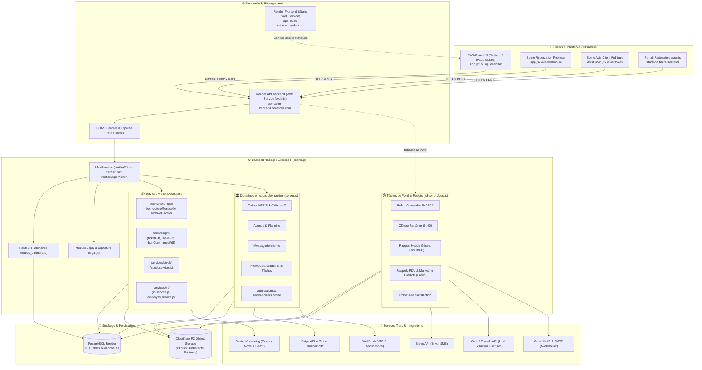
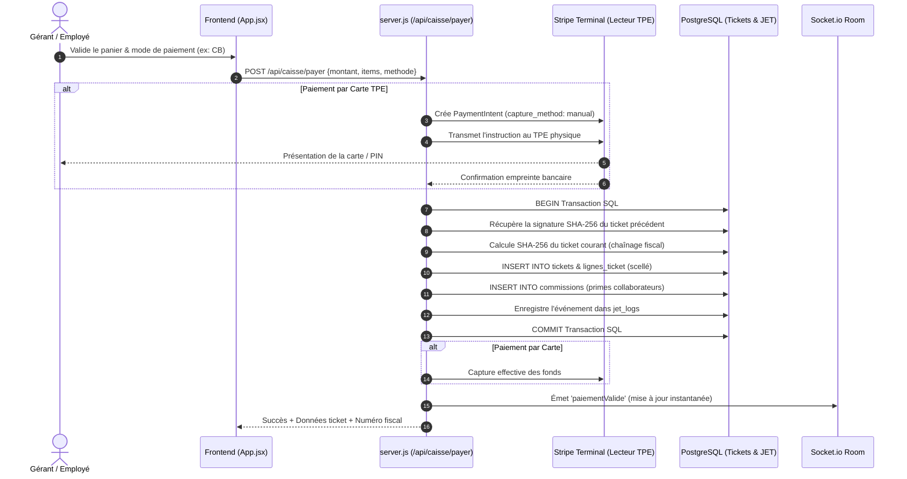
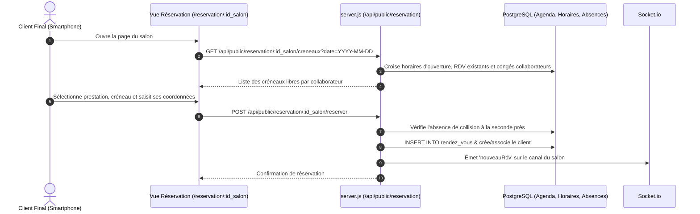
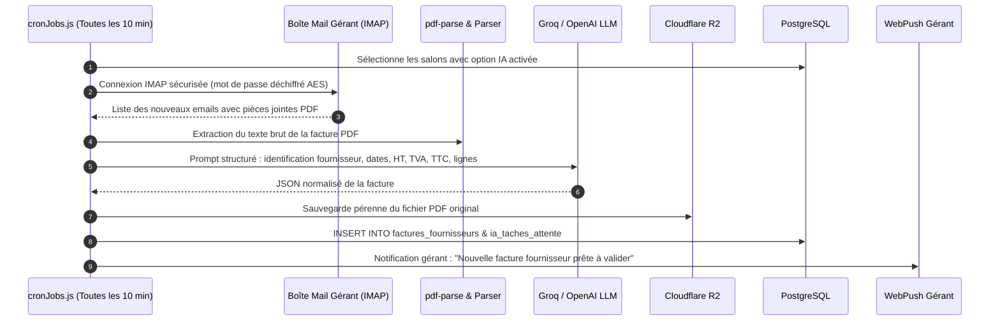
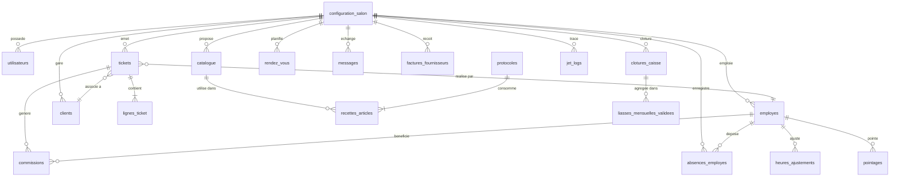

# 🏛️ Architecture Globale — Application STACK

> **Document de référence architectural**  
> *Dernière mise à jour : 05/11/2026*  
> *Statut du code analysé : Répertoire local `APP-GITHUB` (branche `main`)*

---

## 1. Vue d'Ensemble du Système

**STACK** est une plateforme SaaS tout-en-un destinée aux gérants et équipes de salons de coiffure et instituts de beauté. L'application combine :
1. **Un terminal point de vente (Smart POS)** certifié conforme à la norme fiscale **NF525** (inaltérabilité, traçabilité, conservation, archivage).
2. **Un agenda métier et une borne de réservation en ligne** publique avec calcul dynamique de créneaux.
3. **La gestion des collaborateurs (RH)** : pointeuse digitale, calcul des heures travaillées, suivi des commissions, primes, gestion des congés et arrêts avec justificatifs sécurisés.
4. **La gestion prédictive des stocks** et le réassort automatique auprès des fournisseurs avec bons de commande PDF.
5. **Un robot comptable autonome (IA)** capable d'ingérer les emails fournisseurs (IMAP), d'extraire les données des factures PDF (Groq/OpenAI) et de préparer les écritures comptables.
6. **Une liasse fiscale et export FEC** (Fichier des Écritures Comptables) conforme aux normes DGI.
7. **Un système de marketing relationnel** : relance prédictive des clients dormants (winback) et collecte d'avis de satisfaction via SMS (Brevo).
8. **Une messagerie interne d'équipe** en temps réel (Socket.io) avec audio, photos et réactions.
9. **Un portail dédié aux agents commerciaux partenaires** pour la distribution et l'équipement matériel (TPE Stripe).

---

## 2. Diagramme Architectural Global

---

## 3. Description des Couches Techniques

### 3.1. Couche Frontend (SPA Progressive Web App)
- **Framework** : React 19.2.8 avec Vite 8.3.0.
- **PWA & Offline** : `vite-plugin-pwa`, `sw.js` pour les notifications push web, et `localforage` (IndexedDB) pour le cache hors-ligne du catalogue et du panier caisse.
- **Gestion des états** : Composant racine `App.jsx` agissant comme orchestrateur principal (~11 500 lignes, ~230 hooks d'état), dialoguant avec des composants satellites :
  - `Parametres.jsx` : panneau de configuration salon (TPE, SMS, alertes, forfaits, exports comptables).
  - `LiquidTabBar.jsx` : barre de navigation flottante avec retours haptiques.
  - `PopupLegal.jsx` : modal bloquante de signature contractuelle électronique lors de la première connexion.
  - `PricingModal.jsx` : sélecteur de formules Stripe (Essentiel / Pro / Premium).
  - `AvisPublic.jsx` : vue publique dédiée aux clients recevant un lien SMS de satisfaction.
- **Point de configuration API** : `frontend/src/api/config.js` détecte automatiquement l'hôte (`localhost` vs domaine de production Render) pour router les requêtes.

### 3.2. Couche Passerelle & Contrôle d'Accès
- **Serveur HTTP** : Node.js avec Express 5.2.1.
- **Sécurité Réseau & CORS** : Restriction des origines autorisées (`app-salon-caiss.onrender.com`, `localhost:5173`, `stack-partners-frontend.onrender.com`), transmission des cookies avec `credentials: true`.
- **Limiteurs de Débit (`express-rate-limit`)** :
  - `authLimiter` : protège les endpoints sensibles (`/api/login`, `/api/employes/login-pin`, `/api/register`, `/api/forgot-password`).
  - `limiteurReservationPublique` & `limiteurAvisPublic` : prévient le scraping et les attaques par déni de service sur les routes publiques ouvertes.
- **Authentification & Session** :
  - JWT stockés dans des cookies HTTP-Only (`token`, `sameSite: none`, `secure: true`) et délivrance parallèle d'un `ui_token` pour l'interface React.
  - Middleware `verifierToken` : valide le jeton et extrait le contexte `{ id_salon, role, id_employe }`.
  - Middleware `verifierPlan(['PRO', 'PREMIUM'])` : contrôle d'accès aux fonctionnalités avancées (IA, OCR factures, pointeuse).
  - Middleware `verifierSuperAdmin` : réservé au support technique et administration globale.

### 3.3. Couche Métier & Services Modulaires
Les fonctionnalités clés sont organisées en modules autonomes injectant leurs dépendances :
- `services/pdf/` : moteurs de rendu vectoriel PDFKit pour tickets de caisse scellés, liasses mensuelles certifiées et bons de commande fournisseurs.
- `services/compta/` : génération du Fichier des Écritures Comptables (FEC), archivage fiscal scellé et clôtures de fin de mois.
- `services/stock/` : algorithme prédictif de rupture selon l'historique des ventes, gestion des alertes d'inventaire, fusion d'articles et réassort.
- `services/rh/` : calcul analytique des heures travaillées, gestion du pointage direct, détection des conflits d'agenda lors des arrêts, et anonymisation conforme NF525/RGPD.

### 3.4. Couche Données (PostgreSQL & Stockage Objets)
- **Base relationnelle** : PostgreSQL (hébergée sur Render, client `pg.Pool`).
- **Stockage Cloudflare R2** : Compatible Amazon S3 (`@aws-sdk/client-s3`), utilisé pour les photos de profil, les justificatifs médicaux confidentiels (avec URLs présignées éphémères de 15 minutes) et les factures fournisseurs numérisées.
- **Chiffrement applicatif** : Les informations confidentielles (mots de passe boîtes mail IMAP des salons) sont chiffrées en base via **AES-256-CBC** (`crypto.createCipheriv`).

### 3.5. Couche Temps Réel & Tâches Asynchrones
- **WebSockets (`socket.io`)** : Synchronisation immédiate des modifications de caisse, prise de RDV, pointage des collaborateurs et messagerie interne.
- **Server-Sent Events (`/api/events/:id_salon`)** : Flux d'événements unidirectionnel pour alerter le gérant des notifications urgentes.
- **WebPush (VAPID)** : Notifications système sur mobiles et tablettes gérants/employés, même lorsque l'application est en arrière-plan.
- **Crons (`node-cron`)** : Filet de sécurité à 3h du matin (clôture Z automatique), lecture périodique des boîtes emails, envoi des bilans comptables et SMS de relance.

---

## 4. Flux de Données Majeurs

### 4.1. Flux d'Encaissement & Scellement NF525

### 4.2. Flux de Réservation Publique sans Authentification

### 4.3. Flux du Robot Comptable Autonome (IA)

---

## 5. Schéma Entités / Relations Principal (BDD)

