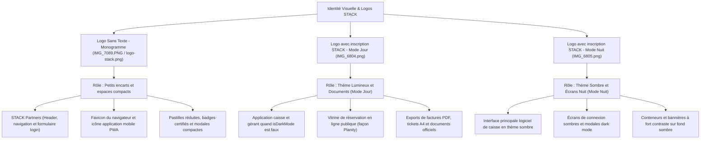

# 🎨 Charte Graphique & Cartographie des Logos — Écosystème STACK

Ce document définit les règles d'utilisation des différents formats et variantes de logos pour l'ensemble des applications de la suite **STACK** (Logiciel Gérant, Borne de Réservation Publique, Portail Partenaires STACK Partners).

---

## 1. Vue Synthétique & Schéma d'Attribution



---

## 2. Inventaire Détaillé des Fichiers

### 1. Logo Sans Texte (Monogramme) — `IMG_7089.PNG` / `/logo-stack.png`
- **Fichier original** : `IMG_7089.PNG` (racine)
- **Fichiers publics servis** : `/frontend/public/logo-stack.png` et `/frontend/public/IMG_7089.PNG`
- **Description** : Symbole graphique stylisé sans mention textuelle.
- **Rôle et usages** :
  - **Petits encarts & conteneurs réduits** où le texte "STACK" surchargerait la mise en page.
  - **Portail STACK Partners** : Header supérieur du dashboard (`NavbarPartners.jsx`), icône d'en-tête de la modale de login (`LoginPartners.jsx`).
  - **Favicon et icônes d'application** : PWA, manifest.json, notifications système.
  - **Avatars et pastilles compactes** : badges d'établissement certifié, icônes de chargement (loaders).

### 2. Logo Mode Jour avec Inscription "STACK" — `/IMG_6804.png`
- **Fichier servi** : `/frontend/public/IMG_6804.png`
- **Description** : Symbole STACK avec le lettrage textuel foncé/contrasté conçu pour des fonds blancs ou clairs.
- **Rôle et usages** :
  - **Mode Jour (`isDarkMode === false`)** : Affiché dans la barre latérale ou l'en-tête du logiciel gérant.
  - **Vitrine de Réservation Publique** : En-tête de la page de réservation client façon Planity.
  - **Génération de documents PDF** : En-tête des factures, justificatifs de caisse, et exports fiscaux A4 destinés à l'impression.

### 3. Logo Mode Nuit avec Inscription "STACK" — `/IMG_6805.png`
- **Fichier servi** : `/frontend/public/IMG_6805.png`
- **Description** : Symbole STACK avec le lettrage textuel clair conçu pour des fonds sombres ou noirs.
- **Rôle et usages** :
  - **Mode Nuit (`isDarkMode === true`)** : Affiché dans la navigation latérale et l'écran de caisse en thème sombre.
  - **Écran de Connexion Sombre** : Page d'authentification du logiciel de caisse (`LoginView.jsx`).
  - **Bannières et encarts haute visibilité** sur fond noir ou violet profond.

---

## 3. Règle d'Implémentation dans le Code React

```jsx
// Exemple de sélection dynamique selon le thème dans le logiciel de caisse :


// Exemple pour petits encarts compacts ou STACK Partners :

```
