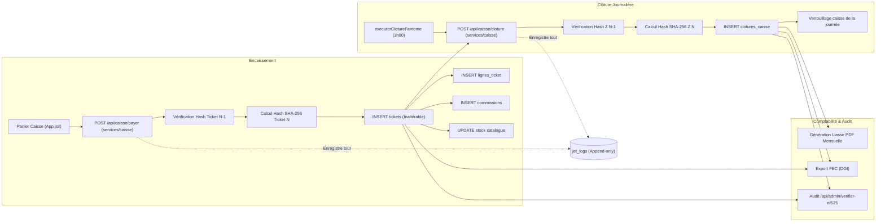
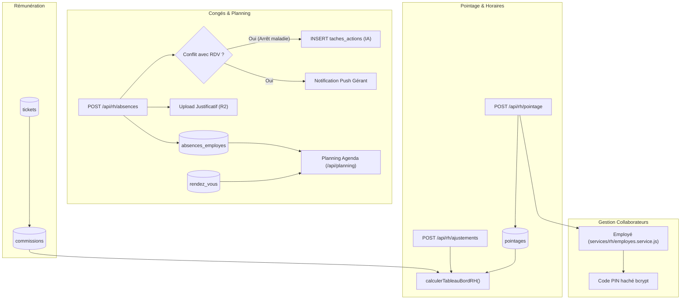
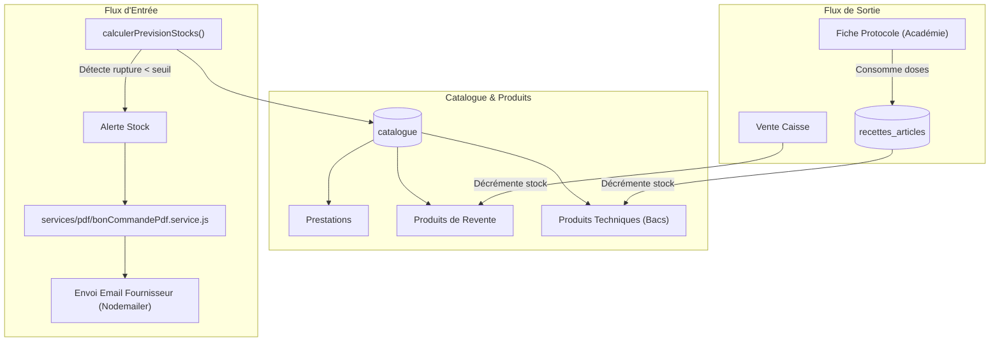

# 🕸️ Carte des Dépendances — Application STACK

> **Analyse structurelle des couplages, flux et risques de régression**  
> *Dernière mise à jour : 05/11/2026*  
> *Statut du code analysé : Répertoire local `APP-GITHUB` (branche `main`)*

---

## 1. Dépendances Globales de l'Architecture

Ce diagramme met en évidence les **composants carrefours** (utilisés par la quasi-totalité de l'application) et les modules plus périphériques.

```mermaid
flowchart TD
    %% Nœuds centraux
    DB[(PostgreSQL Pool)]
    JWT["Middleware Auth (verifierToken)"]
    JET["Module d'Audit NF525 (jet_logs)"]
    Socket["Serveur WebSocket (io)"]
    R2["Cloudflare R2 (S3 Storage)"]

    %% Modules Métier
    Auth["1. Auth & Sécurité"]
    Caisse["2. Caisse NF525"]
    Cloture["3. Clôture Z & Fantôme"]
    Agenda["5. Agenda & Planning"]
    Booking["6. Réservation Publique"]
    RH["8-11. RH, Pointage & Absences"]
    Stock["13-14. Stocks & Catalogue"]
    Chat["17. Messagerie Interne"]
    IA["21. Robot IA & Factures"]
    Compta["22. Liasse & FEC"]
    Salons["23. Multi-Salons"]
    StripeSub["24. Abonnements Stripe"]

    %% Connexions transversales
    Auth --> DB
    Auth --> JWT
    Auth --> JET

    Caisse --> DB
    Caisse --> JWT
    Caisse --> JET
    Caisse --> Socket
    Caisse -.->|"Décrémente"| Stock
    Caisse -.->|"Alimente"| RH
    Caisse -.->|"Conditionné par"| Cloture

    Cloture --> DB
    Cloture --> JET
    Cloture -.->|"Alimente"| Compta

    Agenda --> DB
    Agenda --> JWT
    Agenda --> Socket
    Agenda -.->|"Bloqué par"| RH

    Booking --> DB
    Booking --> Socket
    Booking -.->|"Crée RDV dans"| Agenda

    RH --> DB
    RH --> JWT
    RH --> JET
    RH --> Socket
    RH --> R2

    Stock --> DB
    Stock --> JWT
    Stock --> JET

    Chat --> DB
    Chat --> JWT
    Chat --> Socket

    IA --> DB
    IA --> R2
    IA -.->|"Alimente"| Compta

    Compta --> DB
    Compta --> JET

    Salons --> DB
    Salons --> JWT
    Salons --> JET

    StripeSub --> DB
    StripeSub --> JWT

    classDef critical fill:#ff4d4f,stroke:#fff,stroke-width:2px,color:#fff;
    classDef high fill:#fa8c16,stroke:#fff,stroke-width:2px,color:#fff;
    classDef medium fill:#1890ff,stroke:#fff,stroke-width:2px,color:#fff;
    classDef shared fill:#722ed1,stroke:#fff,stroke-width:2px,color:#fff;

    class Caisse,Cloture,JET critical;
    class DB,JWT,Socket shared;
    class RH,Stock,Agenda,Compta high;
    class Booking,Chat,IA,Salons,StripeSub medium;
```

---

## 2. Dépendances par Domaine Fonctionnel

### 2.1. Le Cœur Transactionnel & Fiscal (NF525)

C'est la chaîne la plus critique de l'application. Une régression sur l'un de ces maillons invalide la conformité fiscale légale du salon.

---

### 2.2. Le Module RH, Absences & Agenda

---

### 2.3. Le Module Stocks, Catalogue & Académie

---

## 3. Matrice d'Interdépendance des Fonctionnalités

Le tableau ci-dessous indique pour chaque fonctionnalité son niveau d'interconnexion :
- **Autonome** : Peut fonctionner ou être modifiée sans impacter le reste du système.
- **Dépendante** : Consomme des données d'autres modules.
- **Centrale** : D'autres modules majeurs dépendent directement de son fonctionnement.

| # | Fonctionnalité | Type | Dépend de | Impacte directement |
|---|---|---|---|---|
| **1** | Authentification & Sécurité | **Centrale** | Base de données | 100% des modules (sécurisation JWT) |
| **2** | Caisse NF525 & Encaissement | **Centrale** | Auth, Catalogue, Employés, Clôtures | Stocks, Commissions RH, Clôture Z, FEC, JET |
| **3** | Clôture de Caisse (Z) | **Centrale** | Tickets de caisse, Mouvements | Caisse (blocage), Liasse, FEC, Archive |
| **4** | Journal Technique (JET) | **Centrale** | Base de données | Audit fiscal NF525, Traçabilité légale |
| **5** | Agenda & Planning | **Dépendante** | Employés, Clients, Absences | Caisse (transformation RDV en ticket), SMS |
| **6** | Réservation Publique | **Dépendante** | Horaires salon, Absences, Catalogue | Agenda (création RDV), Fichier Clients |
| **7** | Fichier Clients | **Mixte** | Base de données | Caisse, Agenda, Avis, Marketing SMS |
| **8** | Collaborateurs & PIN | **Centrale** | Base de données | Caisse, Agenda, Pointage, Commissions, RH |
| **9** | Pointeuse & Horaires | **Dépendante** | Employés | Tableau de bord RH |
| **10** | Commissions & Primes | **Dépendante** | Tickets, Employés | Tableau de bord RH |
| **11** | Absences & Justificatifs R2 | **Dépendante** | Employés, Cloudflare R2 | Agenda (blocage créneaux), Planning |
| **12** | Gamification & Objectifs | **Dépendante** | Tickets, Commissions, Employés | Tableau de bord mobile collaborateur |
| **13** | Stocks & Catalogue | **Centrale** | Base de données | Caisse, Bons de commande, Protocoles |
| **14** | Bons de Commande PDF | **Dépendante** | Catalogue, Stocks, Fournisseurs | Fournisseurs externes |
| **15** | Protocoles & Académie | **Dépendante** | Catalogue (recettes), R2 | Stocks (décompte doses) |
| **16** | Tâches d'Action | **Autonome** | Base de données | Organisation interne gérant |
| **17** | Messagerie Interne | **Autonome** | Employés, Socket.io | Notifications push |
| **18** | Notifications (Push & SSE) | **Centrale** | VAPID, WebPush, SSE | Messagerie, Agenda, Arrêts RH, Robot IA |
| **19** | Avis Clients & Réputation | **Dépendante** | Tickets, Clients, SMS Brevo | e-Réputation Google, Fiches RH |
| **20** | Marketing Prédictif SMS | **Dépendante** | Tickets, Clients, Agenda, Brevo | Rétention client, Chiffre d'affaires |
| **21** | Robot Comptable IA | **Mixte** | IMAP, Groq LLM, R2 | Tâches en attente, Factures, Compta |
| **22** | Liasse Mensuelle & FEC | **Dépendante** | Clôtures Z, Tickets, Factures | Expert-comptable, Fisc |
| **23** | Multi-Établissements | **Centrale** | Auth, Salons | Contexte global de l'application |
| **24** | Abonnements Stripe | **Centrale** | Stripe API, Webhooks | Droits d'accès aux fonctionnalités (Plan) |
| **25** | Portail Partenaires | **Isolé** | Base de données (Pool propre) | Équipement TPE Stripe des salons |
| **26** | Signature Électronique | **Centrale** | Base de données, Auth | Déblocage de l'accès au logiciel |
| **27** | Super-Administration | **Isolé** | Comptes gérants, Crons | Maintenance et support |

---

## 4. Composants Centraux & Risques de Goulot d'Étranglement

### 4.1. Le Pool de Connexions PostgreSQL (`pg.Pool`)
- **Situation actuelle** :
  - `config/db.js` instancie et exporte le pool unique partagé entre toutes les requêtes Express, les crons et les services métiers.
  - `routes_partners.js` instancie son propre pool dédié.
- **Risque** :
  - Épuisement de la limite de connexions PostgreSQL autorisée par Render (ex: 20 à 50 connexions max sur les plans standards).
  - Un pic d'activité sur le portail partenaires peut faire tomber le serveur de caisse en production.

### 4.2. Le Serveur WebSocket (`socket.io`)
- **Rôle** : Reçoit et diffuse en direct :
  - `paiementValide` (synchronisation caisse multi-écrans).
  - `nouveauRdv` (mise à jour instantanée de l'agenda).
  - `statutPointageUpdate` (chronomètre de la pointeuse).
  - `nouveauMessage` & `reactionMessageUpdate` (chat).
- **Risque** :
  - En cas de perte de connexion WebSocket, le client bascule en mode dégradé mais doit interroger l'API en polling.
  - Une fuite mémoire sur les listeners WebSocket impacterait tous les utilisateurs connectés.

### 4.3. Le Fichier Géant Frontend `frontend/src/App.jsx`
- **Rôle** : Contient **230 hooks React** et **11 550 lignes de JSX**.
- **Risque** :
  - Un re-render involontaire d'un état global entraîne le re-calcul complet des 11 onglets.
  - Risque d'erreur `#310` ("Rendered more hooks than previous render") dès qu'un hook conditionnel est introduit.

---

## 5. Analyse des Cycles et Couplages Forts

1. **Couplage Caisse <-> Stocks <-> Commissions** :
   - Lorsqu'un ticket est validé, il décrémente les stocks et calcule les commissions dans la même transaction SQL.
   - **Protection en place** : Transaction SQL `BEGIN / COMMIT / ROLLBACK` stricte. Si la mise à jour des stocks ou des commissions échoue, le ticket n'est pas encaissé et l'empreinte CB Stripe est annulée.

2. **Couplage Agenda <-> Absences RH** :
   - La pose d'un arrêt maladie doit vérifier l'agenda, mais l'agenda doit également masquer les plages des collaborateurs absents.
   - **Absence de cycle bloquant** : La relation est unidirectionnelle en BDD (`absences_employes` et `rendez_vous` sont distincts et croisés en lecture via SQL).

3. **Absence de dépendance circulaire dans les services** :
   - L'architecture modulaire mise en place (`services/pdf/`, `services/compta/`, `services/stock/`, `services/rh/`) utilise l'**injection de dépendances**. Les services ne s'importent pas mutuellement en boucle mais reçoivent les clients (`pool`, `s3Client`, `io`) en paramètre.
