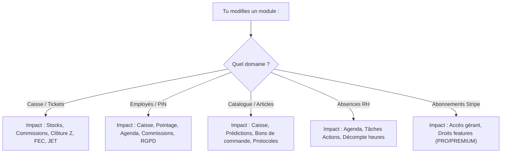

# 🎯 Analyse d'Impact & Guide de Non-Régression — STACK

> **Guide d'intervention sécurisée pour les développeurs et agents IA**  
> *Dernière mise à jour : 05/11/2026*  
> *Statut du code analysé : Répertoire local `APP-GITHUB` (branche `main`)*

---

## 1. Classification de Criticité des Modules

Chaque modification dans le code source doit être jaugée selon l'échelle de criticité suivante :

| Niveau | Criticité | Modules Concernés | Conséquence d'un Bug | Règle d'Or |
|---|---|---|---|---|
| **Niveau 1** | 🔴 **Critique Absolu (Légal & Fiscal)** | Caisse, Encaissement, Clôtures Z, Chaînage SHA-256, `jet_logs`, Export FEC, Liasse fiscale | **Sanctions fiscales pénales pour le salon**, perte de certification NF525 | **Interdiction totale** de `DELETE`/`UPDATE` sur les tables scellées. Double vérification cryptographique. |
| **Niveau 2** | 🟠 **Financier & Monétique** | Stripe Terminal (TPE), Stripe Subscriptions, Webhooks de paiement, Commissions collaborateurs | Perte financière, double débit client, blocage de caisse | Toujours encapsuler dans une transaction SQL et prévoir le rollback Stripe. |
| **Niveau 3** | 🟡 **Opérationnel Salon** | Agenda, Réservation publique, Pointage RH, Stocks, Bons de commande | Salon désorganisé, surbooking, ruptures de stock | Tester la synchronisation temps réel Socket.io multi-écrans. |
| **Niveau 4** | 🟢 **Confort & Outils Secondaires** | Messagerie interne, Avis Google, Tâches actions, Protocoles, IA factures | Gêne temporaire sans impact financier ni légal | Risque limité, test unitaire ou fonctionnel standard. |

---

## 2. Matrice d'Impact Croisée ("Si je modifie X...")

Utilise ce tableau de bord avant **toute modification** d'un fichier du projet :



### Détail des impacts et vérifications obligatoires

#### 1. Si tu touches à `server.js` (Encaissement ou Caisse)
- **Fonctionnalités impactées** : Encaissement physique, calcul de TVA, décrémentation des stocks, génération des primes employés, chaînage cryptographique.
- **Risques majeurs** :
  - Rupture de la chaîne de hachage SHA-256 (`signature_precedente`).
  - Débit bancaire sans création de ticket en base.
  - Décalage de centimes sur la ventilation de TVA.
- **Checklist de vérification** :
  1. [ ] Lancer `node -c server.js`.
  2. [ ] Tester un encaissement espèces (calcul du rendu de monnaie).
  3. [ ] Vérifier que le ticket apparaît dans `tickets` avec une signature valide.
  4. [ ] Lancer l'audit de conformité : `GET /api/admin/verifier-nf525` (doit retourner `"statut": "CONFORME"`).

---

#### 2. Si tu touches à `services/rh/employes.service.js` ou `services/rh/rh.service.js`
- **Fonctionnalités impactées** : Authentification PIN, pointage, tableau de bord gérant, détection des conflits d'agenda, calcul des commissions.
- **Risques majeurs** :
  - Verrouillage intempestif des salariés en caisse.
  - Suppression physique accidentelle d'un employé lié à des tickets fiscaux.
  - Erreur de calcul sur le cumul des heures travaillées ou des primes.
- **Checklist de vérification** :
  1. [ ] Tester la modification du PIN avec un code faible (`1234` doit échouer).
  2. [ ] Tester l'anonymisation RGPD sur un employé avec tickets historiques (le nom devient `Collaborateur Anonymisé #ID`, les tickets restent intacts).
  3. [ ] Vérifier que le calcul des heures ouvertes en cours de journée fonctionne.

---

#### 3. Si tu touches à `services/stock/stock.service.js` ou au catalogue
- **Fonctionnalités impactées** : Panier de caisse, inventaire physique, alertes de réapprovisionnement, bons de commande PDF.
- **Risques majeurs** :
  - Stock négatif non autorisé.
  - Fusion d'articles corrompant les liaisons de tickets passés.
  - Génération d'un bon de commande PDF corrompu.
- **Checklist de vérification** :
  1. [ ] Vérifier le calcul de prévision de rupture (`calculerPrevisionStocks`).
  2. [ ] Générer un bon de commande PDF test et vérifier son intégrité visuelle.
  3. [ ] Vérifier qu'un ajustement manuel de stock crée bien une ligne dans `jet_logs`.

---

#### 4. Si tu touches à `services/protocoles/protocoles.service.js` (Académie & Tâches)
- **Fonctionnalités impactées** : Fiches protocoles coiffure, dosages de recettes produits, téléversement de médias Cloudflare R2, to-do list salon.
- **Risques majeurs** :
  - Échec de signature d'URL R2 ou upload d'images corrompues.
  - Décalage de dosage d'ingrédients techniques dans les fiches recettes.
- **Checklist de vérification** :
  1. [ ] Vérifier la normalisation des étapes et ingrédients.
  2. [ ] Tester la création/modification d'une fiche protocole avec photos.
  3. [ ] Vérifier le bon passage du statut d'une tâche action (`A_FAIRE` <-> `FAIT`).

---

#### 5. Si tu touches à `frontend/src/App.jsx`
- **Fonctionnalités impactées** : L'ensemble des 11 onglets de l'application cliente.
- **Risques majeurs** :
  - **Erreur React #310** : *"Rendered more/fewer hooks than during previous render"*. Écran blanc immédiat à la connexion ou déconnexion.
  - Ralentissement drastique (lag de saisie) dû aux 230 hooks d'état.
- **Checklist de vérification** :
  1. [ ] **Ne JAMAIS ajouter de hook (`useState`, `useEffect`, `useMemo`, `useRef`) sous une condition ou après la ligne 3720** (zone des `if (!token) return`).
  2. [ ] Tester impérativement le cycle complet : Déconnecté -> Connexion Gérant -> Navigation entre tous les onglets -> Déconnexion -> Connexion Employé PIN.
  3. [ ] Vérifier la console navigateur (0 warning de hooks).

---

#### 5. Si tu touches à `jobs/cronJobs.js`
- **Fonctionnalités impactées** : Clôture fantôme de sécurité, relances SMS clients, robot comptable IA, rapport hebdomadaire.
- **Risques majeurs** :
  - Boucle infinie ou surcharge CPU sur le serveur Render.
  - Envoi intempestif de SMS en masse aux clients (coût financier Brevo).
  - Échec de la clôture fantôme laissant la caisse déverrouillée le matin.
- **Checklist de vérification** :
  1. [ ] Vérifier le verrou `isRobotRunning` pour empêcher les exécutions concurrentes.
  2. [ ] Tester le parseur de date (`Date.now()` vs fuseau horaire de Paris).
  3. [ ] Vérifier que la table `robot_memoire_emails` empêche le retraitement en boucle du même email.

---

## 3. Zones Sensibles & Points d'Attention Particuliers

### 🚨 1. Inaltérabilité NF525 & Intégrité Cryptographique
La loi française (article 286 du CGI) impose que chaque encaissement soit scellé par une empreinte numérique incluant la signature du ticket précédent.
- **Ce qui est interdit** :
  - Tout `UPDATE tickets SET ...` (sauf métadonnées non fiscales expressément prévues).
  - Tout `DELETE FROM tickets`.
  - Modifier le calcul de la chaîne SHA-256 : `prevSignature + idTicket + date + totalTTC + tva`.
- **Règle absolue** : Si une vente doit être corrigée, elle fait l'objet d'un ticket négatif (avoir) scellé de la même manière.

### 🚨 2. Le Double Pool PostgreSQL (`server.js` vs `routes_partners.js`)
- `routes_partners.js` instancie son propre `new Pool()`.
- **Recommandation future** : Injecter le `pool` de `server.js` dans le routeur partenaires pour éviter de doubler les connexions PostgreSQL actives sur Render.

### 🚨 3. Données Médicales & Justificatifs d'Absence (Cloudflare R2)
- Les arrêts de travail déposés par les salariés contiennent des données de santé protégées (RGPD renforcé).
- **Règle absolue** : Le bucket R2 ne doit **JAMAIS** être public. L'accès se fait exclusivement par des URLs présignées AWS SDK temporaires expirant au bout de **900 secondes (15 minutes)**.

### 🚨 4. Les Variables d'Environnement Critiques
Si l'une de ces variables est manquante ou altérée dans Render, le serveur plante immédiatement ou se met en défaut :
- `DATABASE_URL` (ou `DB_HOST`, `DB_NAME`, `DB_USER`, `DB_PASSWORD`, `DB_PORT`)
- `JWT_SECRET` / `ENCRYPTION_SECRET` (chiffrement AES et signatures JWT)
- `STRIPE_SECRET_KEY` & `STRIPE_WEBHOOK_SECRET`
- `R2_ACCOUNT_ID`, `R2_ACCESS_KEY_ID`, `R2_SECRET_ACCESS_KEY`, `R2_BUCKET_NAME`
- `GROQ_API_KEY` (extraction OCR des factures fournisseurs)
- `BREVO_API_KEY` (envoi des SMS clients)
- `SMTP_USER` & `SMTP_PASS` (envoi des emails comptables et rapports)

---

## 4. Protocole de Validation Avant Tout Commit / Push

Avant chaque envoi vers la branche `main` de GitHub, applique scrupuleusement ces 5 étapes :

```bash
# 1. Vérification syntaxique stricte de tous les fichiers modifiés
node -c server.js jobs/*.js services/*/*.js

# 2. Vérification du statut Git (aucun fichier temporaire ou non désiré)
git status

# 3. Vérification des différences (aucun secret ni token en clair)
git diff

# 4. Commit avec message descriptif normé (feat:, fix:, refactor:, etc.)
git commit -m "refactor: ..."

# 5. Push propre sans forçage
git push origin main
```
