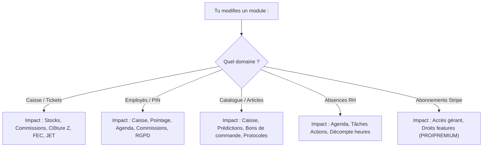

# 🎯 Analyse d'Impact & Guide de Non-Régression — STACK

> **Guide d'intervention sécurisée pour les développeurs et agents IA**  
> *Dernière mise à jour : 05/11/2026*  
> *Statut du code analysé : Répertoire local `APP-GITHUB` (branche `main`)*

---

## 1. Classification de Criticité des Modules

Chaque modification dans le code source doit être jaugée selon l'échelle de criticité suivante :

| Niveau | Criticité | Modules Concernés | Conséquence d'un Bug | Règle d'Or |
|---|---|---|---|---|
| **Niveau 1** | 🔴 **Critique Absolu (Légal & Fiscal)** | Caisse, Encaissement, Clôtures Z, Chaînage SHA-256, `jet_logs`, Export FEC, Liasse fiscale | **Sanctions fiscales pénales pour le salon**, perte de certification NF525 | **Interdiction totale** de `DELETE`/`UPDATE` sur les tables scellées. Double vérification cryptographique. |
| **Niveau 2** | 🟠 **Financier & Monétique** | Stripe Terminal (TPE), Stripe Subscriptions, Webhooks de paiement, Commissions collaborateurs | Perte financière, double débit client, blocage de caisse | Toujours encapsuler dans une transaction SQL et prévoir le rollback Stripe. |
| **Niveau 3** | 🟡 **Opérationnel Salon** | Agenda, Réservation publique, Pointage RH, Stocks, Bons de commande | Salon désorganisé, surbooking, ruptures de stock | Tester la synchronisation temps réel Socket.io multi-écrans. |
| **Niveau 4** | 🟢 **Confort & Outils Secondaires** | Messagerie interne, Avis Google, Tâches actions, Protocoles, IA factures | Gêne temporaire sans impact financier ni légal | Risque limité, test unitaire ou fonctionnel standard. |

---

## 2. Matrice d'Impact Croisée ("Si je modifie X...")

Utilise ce tableau de bord avant **toute modification** d'un fichier du projet :



### Détail des impacts et vérifications obligatoires

#### 1. Si tu touches à `services/caisse/caisse.service.js` ou `services/caisse/dossierNf525Pdf.service.js` (Encaissement, Mouvements, Clôture Z ou NF525)
- **Fonctionnalités impactées** : Encaissement physique, pourboire isolé, annulation/avoir de compensation, calcul de TVA, décrémentation des stocks, génération des primes employés, chaînage cryptographique SHA-256 (tickets, Z, mouvements, JET), audit de conformité et dossier technique légal PDF.
- **Risques majeurs** :
  - Rupture de la chaîne de hachage SHA-256 (`hash_ticket`, `signature_hash`, `hash_mouvement`, `hash_jet`).
  - Débit bancaire sans création de ticket en base (nécessite l'annulation de l'empreinte bancaire Stripe en cas de rollback SQL).
  - Décalage de centimes sur la ventilation de TVA ou le cumul perpétuel.
- **Checklist de vérification** :
  1. [ ] Lancer `node -c server.js services/caisse/*.js`.
  2. [ ] Tester un encaissement espèces / carte (calcul du rendu de monnaie ou capture Stripe).
  3. [ ] Vérifier que le ticket apparaît dans `tickets` avec une signature SHA-256 valide et chaînée au bloc précédent.
  4. [ ] Lancer l'audit de conformité : `GET /api/admin/verifier-nf525` (doit retourner `"conforme": true, "erreurs": []`).
  5. [ ] Tester la génération du Dossier Technique NF525 : `GET /api/admin/dossier-technique-nf525/pdf` (génération vectorielle PDF valide sans timeout).

---

#### 2. Si tu touches à `services/rh/employes.service.js` ou `services/rh/rh.service.js`
- **Fonctionnalités impactées** : Authentification PIN, pointage, tableau de bord gérant, détection des conflits d'agenda, calcul des commissions.
- **Risques majeurs** :
  - Verrouillage intempestif des salariés en caisse.
  - Suppression physique accidentelle d'un employé lié à des tickets fiscaux.
  - Erreur de calcul sur le cumul des heures travaillées ou des primes.
- **Checklist de vérification** :
  1. [ ] Tester la modification du PIN avec un code faible (`1234` doit échouer).
  2. [ ] Tester l'anonymisation RGPD sur un employé avec tickets historiques (le nom devient `Collaborateur Anonymisé #ID`, les tickets restent intacts).
  3. [ ] Vérifier que le calcul des heures ouvertes en cours de journée fonctionne.

---

#### 3. Si tu touches à `services/stock/stock.service.js` ou au catalogue
- **Fonctionnalités impactées** : Panier de caisse, inventaire physique, alertes de réapprovisionnement, bons de commande PDF.
- **Risques majeurs** :
  - Stock négatif non autorisé.
  - Fusion d'articles corrompant les liaisons de tickets passés.
  - Génération d'un bon de commande PDF corrompu.
- **Checklist de vérification** :
  1. [ ] Vérifier le calcul de prévision de rupture (`calculerPrevisionStocks`).
  2. [ ] Générer un bon de commande PDF test et vérifier son intégrité visuelle.
  3. [ ] Vérifier qu'un ajustement manuel de stock crée bien une ligne dans `jet_logs`.

---

#### 4. Si tu touches à `services/protocoles/protocoles.service.js` (Académie & Tâches)
- **Fonctionnalités impactées** : Fiches protocoles coiffure, dosages de recettes produits, téléversement de médias Cloudflare R2, to-do list salon.
- **Risques majeurs** :
  - Échec de signature d'URL R2 ou upload d'images corrompues.
  - Décalage de dosage d'ingrédients techniques dans les fiches recettes.
- **Checklist de vérification** :
  1. [ ] Vérifier la normalisation des étapes et ingrédients.
  2. [ ] Tester la création/modification d'une fiche protocole avec photos.
  3. [ ] Vérifier le bon passage du statut d'une tâche action (`A_FAIRE` <-> `FAIT`).

---

#### 5. Si tu touches à `services/chat/chat.service.js` (Messagerie Interne)
- **Fonctionnalités impactées** : Envoi de messages texte/audio/photos, notifications push mobiles, événements WebSockets multi-écrans.
- **Risques majeurs** :
  - Fuite de messages privés entre employés (isolation stricte par `id_destinataire`).
  - Surcharge Socket.io due à des payloads de médias non compressés.
- **Checklist de vérification** :
  1. [ ] Tester l'envoi d'un message général (salon) et d'un message privé.
  2. [ ] Vérifier la diffusion WebSocket de l'événement `nouveauMessage`.
  3. [ ] Vérifier l'ajout et le retrait d'une réaction emoji (`messageReaction`).

---

#### 6. Si tu touches à `services/marketing/marketing.service.js` (Avis & SMS)
- **Fonctionnalités impactées** : Recueil d'avis clients, redirection Google Business, STOP SMS, envois transactionnels Brevo, offres winback.
- **Risques majeurs** :
  - Non-respect de l'opt-out SMS (violation RGPD et sanctions CNIL/opérateurs).
  - Échec de création de la tâche d'alerte en cas de client mécontent.
- **Checklist de vérification** :
  1. [ ] Tester la prise en compte du STOP SMS (le numéro doit être stocké en base `sms_opt_out`).
  2. [ ] Tester la notation 5★ (redirection Google Maps) vs 2★ (tâche d'action créée pour le gérant).
  3. [ ] Vérifier la bonne gestion de la clé API Brevo manquante ou du solde épuisé.

---

#### 7. Si tu touches à `services/agenda/agenda.service.js` (Agenda & Réservations Publiques)
- **Fonctionnalités impactées** : Planning des collaborateurs, prise de rendez-vous en salon, borne de réservation publique en ligne, calcul des créneaux, synchronisation iCal.
- **Risques majeurs** :
  - Collision de rendez-vous sur le même créneau (double réservation).
  - Mauvais calcul des créneaux disponibles selon les horaires d'ouverture et pauses/absences.
  - Défaillance de la notification push ou broadcast WebSocket lors des annulations en masse.
- **Checklist de vérification** :
  1. [ ] Tester la création, modification d'horaire et suppression d'un rendez-vous interne.
  2. [ ] Tester l'API publique `/api/public/reservation/:id_salon/creneaux` pour vérifier que les créneaux déjà occupés ne sont pas proposés.
  3. [ ] Vérifier la route `/api/ical/:id_salon/:id_employe.ics` pour confirmer la génération d'un calendrier iCalendar valide (RFC 5545).

---

#### 8. Si tu touches à `services/salons/salons.service.js` (Multi-Salons & Portabilité RGPD)
- **Fonctionnalités impactées** : Gestion multi-établissements, création de salon, switch instantané JWT, synchronisation catalogue/Académie, export portabilité RGPD (CSV et JSON scellé NF525).
- **Risques majeurs** :
  - Fuite de données / violation d'isolation entre salons (IDOR sur switch).
  - Échec de duplication du catalogue ou corruption des clés étrangères de recettes d'Académie.
  - Incohérence du scellement SHA-256 de l'archive de portabilité.
- **Checklist de vérification** :
  1. [ ] Tester `POST /api/mes-salons/switch/:id` et vérifier que le nouveau JWT est bien restreint au salon cible.
  2. [ ] Tester l'export portabilité format CSV et JSON complet et vérifier l'intégrité de l'empreinte `scellement_cryptographique_nf525`.

---

#### 9. Si tu touches à `services/stripe/stripe.service.js` (Abonnements & Stripe)
- **Fonctionnalités impactées** : Souscription Stripe Checkout, empreinte bancaire à 0€ pendant l'essai, évolution de forfait, résiliation, gardien des quotas SMS mensuels, webhook Stripe.
- **Risques majeurs** :
  - Blocage injustifié des SMS du salon par dépassement de quota erroné.
  - Non-prise en compte du webhook Stripe laissant le salon bloqué après paiement.
  - Mauvaise gestion des tarifs manquants en environnement de production.
- **Checklist de vérification** :
  1. [ ] Tester `verifierEtIncrementerQuotaSMS` au franchissement de limite (100, 250, 500 SMS).
  2. [ ] Tester la création d'une session Stripe Checkout avec les fallbacks `price_data`.
  3. [ ] Vérifier la signature Webhook Stripe (`stripe.webhooks.constructEvent`).

---

#### 10. Si tu touches à `services/ia/ia.service.js` (Robot IA & OCR Factures)
- **Fonctionnalités impactées** : Extraction automatique des factures (IMAP et upload manuel PDF/image), saisie manuelle de facture sécurisée PIN, double action validation (écriture compta `factures_fournisseurs` + réassort stock catalogue), synchronisation de RDV et détection d'arrêts maladie.
- **Risques majeurs** :
  - Mauvaise extraction de TVA / HT / TTC menant à des déséquilibres comptables.
  - Omission de la sortie de caisse espèces lors du règlement cash d'une dépense.
  - Surcharge mémoire lors du parsing de PDFs volumineux (résolu par streaming R2).
- **Checklist de vérification** :
  1. [ ] Tester `POST /api/ia/upload-facture` avec un PDF test et vérifier la structure JSON normalisée.
  2. [ ] Tester `POST /api/ia/taches/:id/valider` pour une dépense en espèces : vérifier l'insertion dans `factures_fournisseurs`, le scellement `mouvements_caisse` et l'incrément de stock `catalogue`.

---

#### 11. Si tu touches à `services/dashboard/dashboard.service.js` (Dashboards & KPIs)
- **Fonctionnalités impactées** : Tableau de bord gérant (CA, panier moyen, top 3 prestations, NPS, avis Google), métriques salon et commissions collaborateurs.
- **Risques majeurs** :
  - Erreur SQL GROUP BY sur les jointures de lignes tickets et prestations.
  - Timeout ou crash sur l'API externe Google My Business (doit toujours être protégée par un `try/catch` non bloquant).
- **Checklist de vérification** :
  1. [ ] Tester `GET /api/dashboard` et vérifier que le calcul du panier moyen et le top 3 prestations sont cohérents.
  2. [ ] Tester `GET /api/dashboard/employe` avec un token collaborateur et vérifier l'isolation des données.

---

#### 12. Si tu touches à `services/admin/superadmin.service.js` (Super-Administration)
- **Fonctionnalités impactées** : Statistiques globales MRR, changement de statut salon, purge complète de salon, déclenchement forcé des robots, simulateur temporel.
- **Risques majeurs** :
  - Violation d'accès God mode si le middleware `verifierSuperAdmin` est altéré.
  - Destruction accidentelle d'archives fiscales NF525 lors de la purge d'un salon (les tables de tickets et JET doivent TOUJOURS être conservées).
- **Checklist de vérification** :
  1. [ ] Tester l'accès avec un compte non superadmin : HTTP 403 obligatoire.
  2. [ ] Vérifier que la purge salon (`DELETE /api/superadmin/salons/:id`) préserve expressément `tickets`, `clotures_caisse` et `jet_logs`.

---

#### 13. Si tu touches à `frontend/src/App.jsx`
- **Fonctionnalités impactées** : L'ensemble des 11 onglets de l'application cliente.
- **Risques majeurs** :
  - **Erreur React #310** : *"Rendered more/fewer hooks than during previous render"*. Écran blanc immédiat à la connexion ou déconnexion.
  - Ralentissement drastique (lag de saisie) dû aux 230 hooks d'état.
- **Checklist de vérification** :
  1. [ ] **Ne JAMAIS ajouter de hook (`useState`, `useEffect`, `useMemo`, `useRef`) sous une condition ou après la ligne 3720** (zone des `if (!token) return`).
  2. [ ] Tester impérativement le cycle complet : Déconnecté -> Connexion Gérant -> Navigation entre tous les onglets -> Déconnexion -> Connexion Employé PIN.
  3. [ ] Vérifier la console navigateur (0 warning de hooks).

---

#### 14. Si tu touches à `jobs/cronJobs.js`
- **Fonctionnalités impactées** : Clôture fantôme de sécurité, relances SMS clients, robot comptable IA, rapport hebdomadaire.
- **Risques majeurs** :
  - Boucle infinie ou surcharge CPU sur le serveur Render.
  - Envoi intempestif de SMS en masse aux clients (coût financier Brevo).
  - Échec de la clôture fantôme laissant la caisse déverrouillée le matin.
- **Checklist de vérification** :
  1. [ ] Vérifier le verrou `isRobotRunning` pour empêcher les exécutions concurrentes.
  2. [ ] Tester le parseur de date (`Date.now()` vs fuseau horaire de Paris).
  3. [ ] Vérifier que la table `robot_memoire_emails` empêche le retraitement en boucle du même email.

---

#### 15. Si tu touches à `services/auth/auth.service.js` ou `config/db.js` (Sécurité, Sessions & BDD)
- **Fonctionnalités impactées** : 100% des accès gérants et employés, vérification des rôles, signatures JWT, déclenchement des triggers inaltérables NF525, pool relationnel PostgreSQL.
- **Risques majeurs** :
  - Rejet universel des requêtes (`verifierToken` renvoyant 401/403).
  - Blocage accidentel de l'initialisation de schéma ou altération des triggers PostgreSQL (`nf525_prevent_alteration`).
  - Défaillance du verrouillage PIN entraînant une vulnérabilité aux attaques par force brute.
- **Checklist de vérification** :
  1. [ ] Lancer `node -c server.js config/*.js services/auth/*.js`.
  2. [ ] Valider la présence de `ENCRYPTION_SECRET` et `JWT_SECRET`.
  3. [ ] Tester le login gérant, le login PIN employé, et le blocage à 3, 5, 7, 9 tentatives.
  4. [ ] Tester le reset de mot de passe par email.

---

#### 16. Si tu touches à `services/settings/`, `services/clients/` ou `services/notifications/` (Services Transverses)
- **Fonctionnalités impactées** : Configuration du salon, checklist d'onboarding, annuaire clients, flux SSE et push web, SMS transactionnels.
- **Risques majeurs** :
  - Suppression physique d'un client au lieu d'une anonymisation pseudonymisée (violation fiscale si des tickets sont rattachés).
  - Déconnexion silencieuse des flux SSE en caisse.
  - Fuite des identifiants sensibles de messagerie IMAP ou Pennylane aux employés.
- **Checklist de vérification** :
  1. [ ] Lancer `node -c server.js services/settings/*.js services/clients/*.js services/notifications/*.js`.
  2. [ ] Vérifier que la suppression d'un client avec tickets bascule en anonymisation `Client Anonymisé #ID` avec log JET.
  3. [ ] Vérifier que les paramètres renvoyés aux employés masquent les clés et mots de passe sensibles.

---

## 3. Zones Sensibles & Points d'Attention Particuliers

### 🚨 1. Inaltérabilité NF525 & Intégrité Cryptographique
La loi française (article 286 du CGI) impose que chaque encaissement soit scellé par une empreinte numérique incluant la signature du ticket précédent.
- **Ce qui est interdit** :
  - Tout `UPDATE tickets SET ...` (sauf métadonnées non fiscales expressément prévues).
  - Tout `DELETE FROM tickets`.
  - Modifier le calcul de la chaîne SHA-256 : `prevSignature + idTicket + date + totalTTC + tva`.
- **Règle absolue** : Si une vente doit être corrigée, elle fait l'objet d'un ticket négatif (avoir) scellé de la même manière.

### 🚨 2. Le Double Pool PostgreSQL (`server.js` vs `routes_partners.js`)
- `routes_partners.js` instancie son propre `new Pool()`.
- **Recommandation future** : Injecter le `pool` de `server.js` dans le routeur partenaires pour éviter de doubler les connexions PostgreSQL actives sur Render.

### 🚨 3. Données Médicales & Justificatifs d'Absence (Cloudflare R2)
- Les arrêts de travail déposés par les salariés contiennent des données de santé protégées (RGPD renforcé).
- **Règle absolue** : Le bucket R2 ne doit **JAMAIS** être public. L'accès se fait exclusivement par des URLs présignées AWS SDK temporaires expirant au bout de **900 secondes (15 minutes)**.

### 🚨 4. Les Variables d'Environnement Critiques
Si l'une de ces variables est manquante ou altérée dans Render, le serveur plante immédiatement ou se met en défaut :
- `DATABASE_URL` (ou `DB_HOST`, `DB_NAME`, `DB_USER`, `DB_PASSWORD`, `DB_PORT`)
- `JWT_SECRET` / `ENCRYPTION_SECRET` (chiffrement AES et signatures JWT)
- `STRIPE_SECRET_KEY` & `STRIPE_WEBHOOK_SECRET`
- `R2_ACCOUNT_ID`, `R2_ACCESS_KEY_ID`, `R2_SECRET_ACCESS_KEY`, `R2_BUCKET_NAME`
- `GROQ_API_KEY` (extraction OCR des factures fournisseurs)
- `BREVO_API_KEY` (envoi des SMS clients)
- `SMTP_USER` & `SMTP_PASS` (envoi des emails comptables et rapports)

---

## 4. Protocole de Validation Avant Tout Commit / Push

Avant chaque envoi vers la branche `main` de GitHub, applique scrupuleusement ces 5 étapes :

```bash
# 1. Vérification syntaxique stricte de tous les fichiers modifiés
node -c server.js jobs/*.js services/*/*.js

# 2. Vérification du statut Git (aucun fichier temporaire ou non désiré)
git status

# 3. Vérification des différences (aucun secret ni token en clair)
git diff

# 4. Commit avec message descriptif normé (feat:, fix:, refactor:, etc.)
git commit -m "refactor: ..."

# 5. Push propre sans forçage
git push origin main
```
